# AWS Defense in Depth: Terraform, Jenkins, Prometheus, Grafana and AI


> A small AWS environment that is deployed **only** through a gated Jenkins pipeline. Every change is secret-scanned, security-scanned, planned, reviewed by an AI model, approved by a human, applied, and smoke-tested. Each security layer has a control **and** a test that proves it works.

## Contents

[Overview](#overview) · [Architecture](#architecture) · [Defense-in-depth layers](#defense-in-depth-layers) · [Tech stack](#tech-stack) · [Walkthrough](#walkthrough) · [Challenges and fixes](#challenges-and-fixes) · [Skills demonstrated](#skills-demonstrated) · [Setup guide](#setup-guide) · [Limitations and next steps](#limitations-and-next-steps) · [Cost and cleanup](#cost-and-cleanup)

## Overview

Most "defense in depth" demos stop at a diagram. This project builds the whole thing and then attacks it:

- **Infrastructure as code:** a custom VPC with public and private subnets, NACLs, security groups, IAM roles, VPC flow logs and two EC2 hosts, all defined in Terraform with remote state in S3.
- **Automation:** nothing is deployed by hand. Jenkins runs a pipeline that scans, plans, reviews, waits for approval, applies and verifies.
- **AI in the loop:** an LLM reads the Checkov findings and the Terraform plan and writes a plain-English risk review before a human approves.
- **Observability:** Prometheus, Grafana and a blackbox exporter run on a private host with no inbound access, reached only through an SSM tunnel.
- **Proof:** blocked ports, real internet scanners rejected in the flow logs, a simulated outage that fires an alert, and a clean teardown are all shown with screenshots below.

### Key results

| Metric | Result |
|---|---|
| Resources managed by Terraform | 47, created and destroyed with one command each |
| Pipeline stages | 9 (checkout, secrets scan, IaC scan, init and validate, plan, AI review, approval, apply, smoke test) |
| Checkov scan, before remediation | 139 passed, 13 failed |
| Checkov scan, after remediation | **144 passed, 8 failed** (5 findings fixed, the rest triaged and documented) |
| Internet-facing ports on the web tier | 1 (HTTP 80). Ports 22 and 9100 verified closed |
| Inbound rules on the monitoring tier | 0 |
| SSH keys or bastion hosts | 0 (SSM Session Manager only) |
| Blocked probes caught in flow logs | 18 rejected port-22 attempts in a one-hour window |
| Outage detection | Prometheus alert fired about 2 minutes after a simulated failure |

## Architecture


## Defense-in-depth layers

| Layer | Control | How it is proven |
|---|---|---|
| Pipeline | gitleaks secret scan, Checkov IaC scan, fmt/validate, manual approval gate | [Pipeline run](#3-security-gates-in-the-pipeline) |
| Network | Custom VPC, public/private subnets, stateless NACLs, zero inbound to the monitor tier | [Port tests](#6-proving-the-defenses-work) |
| Host | Security groups, SSM only (no SSH or key pairs), IMDSv2 required, encrypted EBS | Port tests, tunnel screenshot |
| Identity and secrets | One IAM role per host, Grafana password generated by Terraform and stored in SSM SecureString | No secrets in the repo or user_data |
| Detection | VPC Flow Logs, Prometheus alert rules | [Flow logs and alert](#6-proving-the-defenses-work) |
| AI review | LLM summarizes risk before approval | [AI review](#3-security-gates-in-the-pipeline) |

## Tech stack

| Area | Tools |
|---|---|
| Cloud | AWS (VPC, EC2, IAM, SSM, S3, CloudWatch) |
| IaC | Terraform with S3 remote state and native locking |
| CI/CD | Jenkins (containerized, pipeline as code from Git) |
| Security scanning | gitleaks, Checkov |
| Monitoring | Prometheus, Blackbox exporter, node_exporter, Grafana |
| AI | Google Gemini API, called from a Python script |
| Dev environment | Windows, VS Code, PowerShell, Docker Desktop, Git |

## Repository structure

```
aws-defense-in-depth/
├── Jenkinsfile                  # 9-stage declarative pipeline
├── jenkins/
│   ├── Dockerfile               # Jenkins + Terraform, Checkov, gitleaks, AWS CLI
│   └── docker-compose.yml
├── scripts/
│   └── ai_review.py             # AI risk review (advisory, never blocks the build)
├── terraform/
│   ├── versions.tf  variables.tf  outputs.tf
│   ├── network.tf               # VPC, subnets, NAT, route tables, NACLs
│   ├── security.tf              # security groups, IAM roles, SSM secret
│   ├── compute.tf               # EC2 hosts (IMDSv2, encrypted disks)
│   ├── detection.tf             # VPC flow logs
│   └── templates/               # user-data for the web and monitor hosts
└── docs/screenshots/
```

## Walkthrough

### 1. Remote state in S3

Terraform state lives in a versioned, private S3 bucket with native state locking, so the pipeline can be rebuilt without losing track of what exists. The bucket is created by hand because Terraform cannot create the bucket that stores its own state.

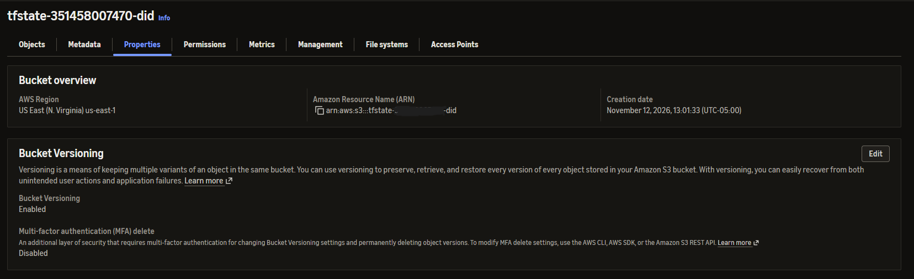
*Versioning enabled on the state bucket in us-east-1.*

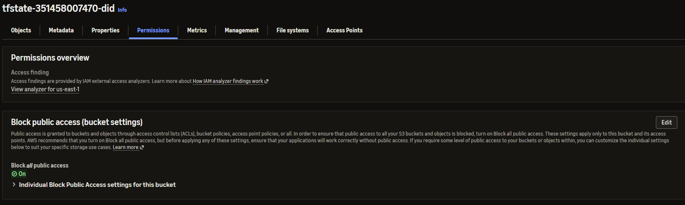
*Block all public access is on.*

### 2. Jenkins in Docker, wired to GitHub

A custom Jenkins image bakes in Terraform, Checkov, gitleaks and the AWS CLI so every build uses the same pinned tools. The job reads the `Jenkinsfile` from this repository, so the pipeline is versioned with the code it deploys.

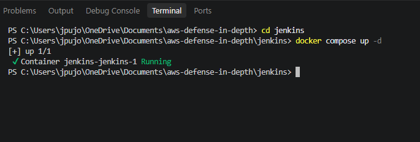

*Jenkins container started with Docker Compose.*

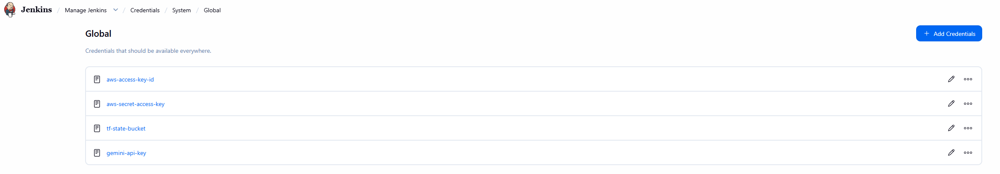
*Four secret-text credentials. Keys, the AI token and the state bucket name live only in Jenkins, never in Git.*

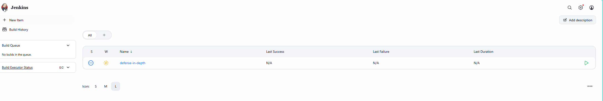
*The pipeline job on the Jenkins dashboard.*

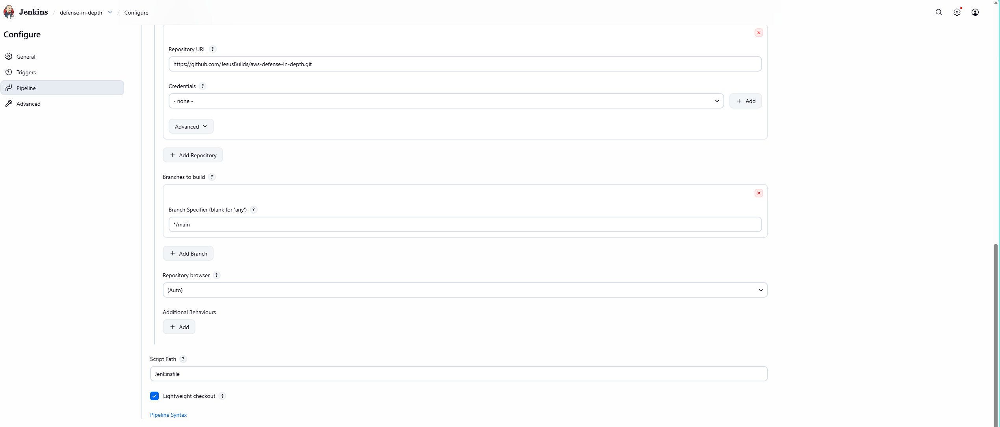
*Pipeline script from SCM: repository URL, `*/main` branch, `Jenkinsfile` script path.*

### 3. Security gates in the pipeline

**Checkov** scans the Terraform before anything is planned. The first scan passed 139 checks and failed 13. I triaged them instead of chasing zero: some are real improvements, some are deliberate trade-offs for a lab, and some are false positives (see the AI review below).

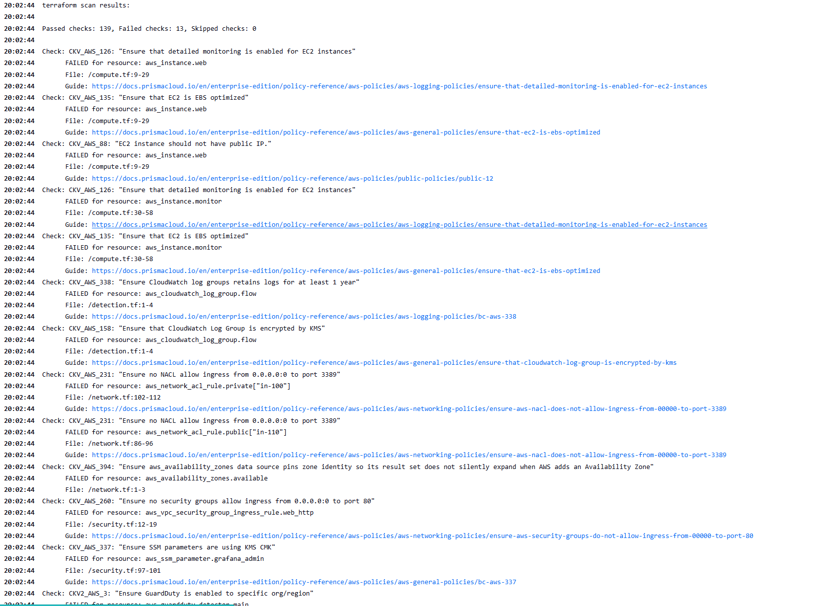
*First scan: 139 passed, 13 failed.*

**AI review.** A Python script sends the Checkov findings and the Terraform plan (never state files or credentials) to a Gemini model. It returns a change summary, ranked risks and an APPLY/HOLD verdict. It is advisory only, retries on rate limits and timeouts, and never fails the build.

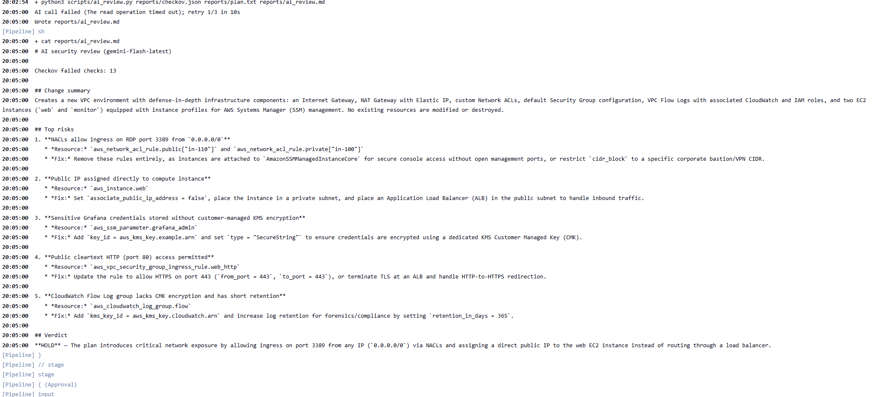
*AI review: summary, top risks and verdict.*

The AI recommended **HOLD** because it repeated a false positive: Checkov flagged RDP port 3389 as open, but that finding comes from the ephemeral return-traffic range (1024-65535) in the NACLs, which happens to include 3389. Nothing listens on RDP. I reviewed the plan, overrode the verdict, and approved. That is exactly why the pipeline keeps a **human approval gate**.

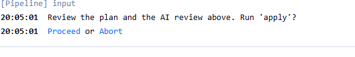

*Manual approval: nothing changes in AWS until a human clicks Proceed.*

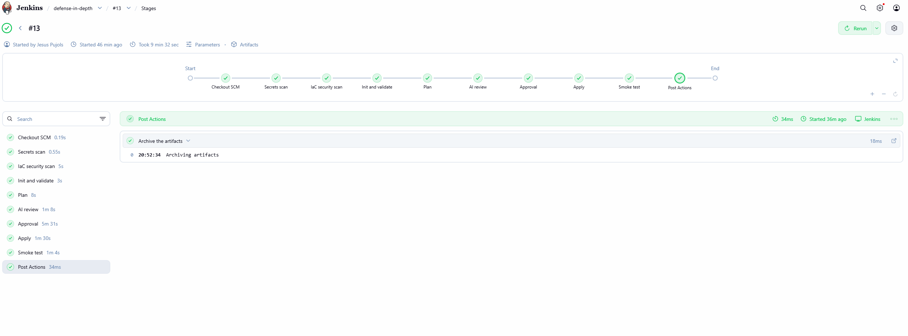

*A complete green run (build #13): every stage passed, including the smoke test.*

### 4. Deployed infrastructure

After approval, Terraform applies the plan and a smoke test curls the new web server before the build can pass.

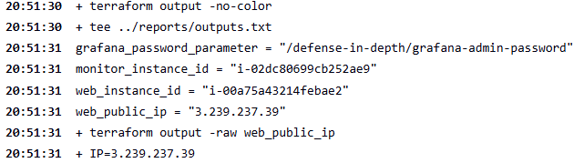

*Terraform outputs: web IP, instance IDs and the name of the SSM parameter holding the Grafana password (not the password itself).*

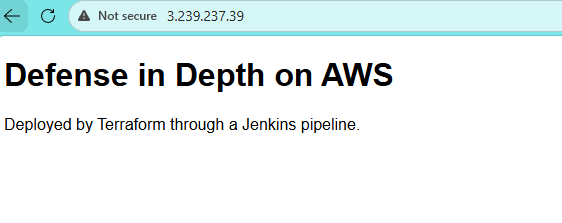

*The web tier serving over HTTP, deployed end to end by the pipeline.*

### 5. Private monitoring, reached through SSM

The monitoring host sits in the private subnet with **no inbound rules at all**. I reach Grafana and Prometheus through an SSM port-forwarding tunnel, so there is no open listener, bastion or SSH key, and access requires an IAM identity and is logged.

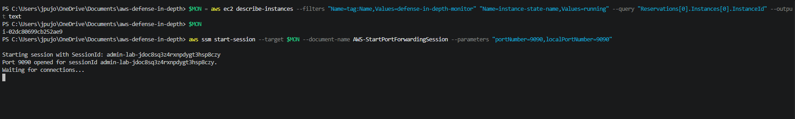

*SSM port-forward to the private monitor host.*

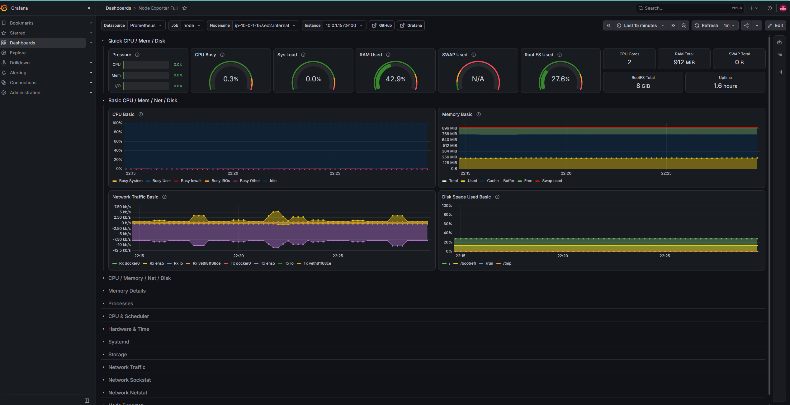

*Node Exporter dashboard showing live CPU, memory, network and disk for the web host.*

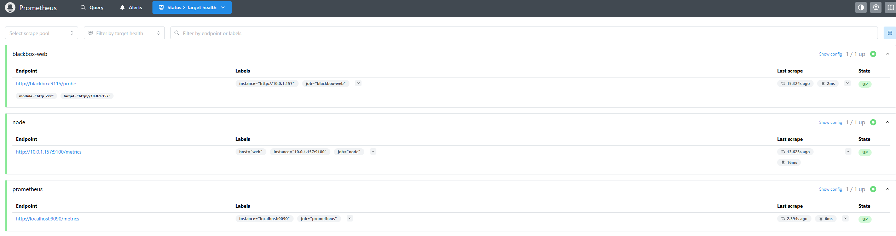

*Prometheus targets: node exporter, blackbox HTTP probe and Prometheus itself, all UP.*

### 6. Proving the defenses work

**Closed ports.** From the internet, only HTTP answers. SSH (22) and the metrics port (9100) time out because the firewall silently drops the packets.

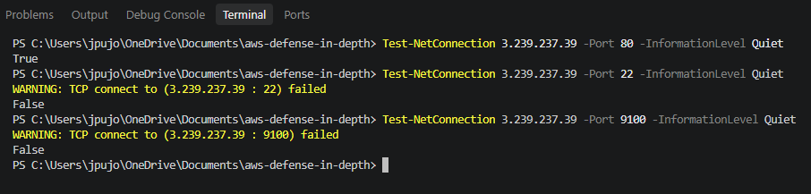

*Port 80 returns True. Ports 22 and 9100 return False.*

**The network saw it.** VPC Flow Logs recorded every blocked connection. Within an hour of going online, automated internet scanners were already probing SSH on the web server, and every attempt was rejected.

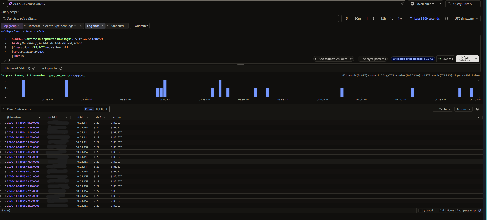

*CloudWatch Logs Insights: 18 rejected port-22 attempts in one hour.*

**Detection and recovery.** I simulated an outage by stopping the web container through SSM, with no SSH. Prometheus caught it through the blackbox probe and fired the alert.

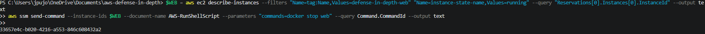

*Stopping the web container remotely through SSM.*

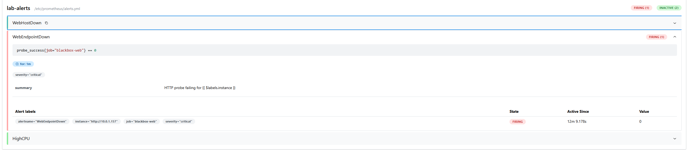

*`WebEndpointDown` in the FIRING state: `probe_success == 0`.*

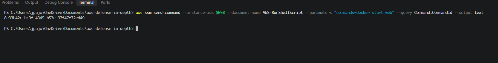

*Bringing the web server back up.*

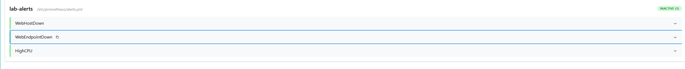

*All alert rules back to normal. The alert cleared on its own.*

### 7. Shift-left results

I fixed the cheap, real findings through the same pipeline: detailed monitoring and EBS optimization on both instances, and 365-day retention on the flow log group. The scan went from 13 failures to 8, with 5 more checks passing.

| Before: 139 passed, 13 failed | After: 144 passed, 8 failed |
|---|---|
|  | 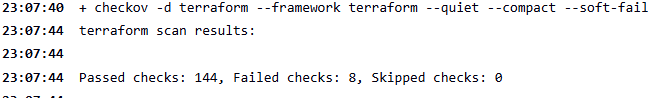 |

The remaining 8 are deliberate and documented:

| Finding | Why it is accepted |
|---|---|
| Public IP and port 80 open on the web tier (2) | The web tier is public by design. Next step is an ALB with HTTPS. |
| KMS keys for the log group and the SSM secret (2) | Customer-managed keys cost money and are overkill for a lab. |
| NACL "port 3389" findings (2) | False positives from the 1024-65535 return-traffic range. Nothing listens on RDP. |
| Availability-zone lookup not pinned (1) | Style recommendation with no security impact here. |
| GuardDuty not enabled in the code path (1) | The lab account does not allow GuardDuty (subscription required). |

### 8. Clean teardown

Everything is destroyed with one command, so the project costs almost nothing to demonstrate.

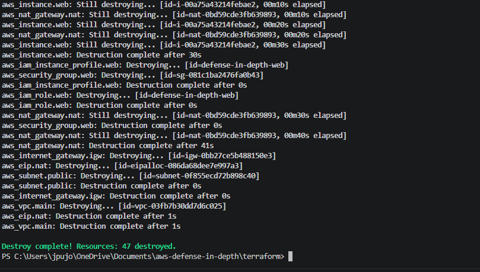

*`Destroy complete! Resources: 47 destroyed.`*

## Challenges and fixes

| Problem | What I saw | Root cause and fix |
|---|---|---|
| Git push rejected | `GH001: Large files detected` (a 685 MB file) | The `.terraform/` provider folder was committed. I fixed `.gitignore` and rebuilt the local history before pushing. |
| GuardDuty failed | `403 SubscriptionRequiredException` | The lab account does not allow GuardDuty. It sits behind a Terraform variable and is disabled by default. |
| AI review failed three different ways | `404`, then `503`, then `429` | A retired model name, then provider overload, then free-tier rate limits. I switched to a rolling model alias, added retries with backoff, and made the step non-blocking. |
| Web page said "refused to connect" | Smoke test failed, nothing on port 80 | The EC2 system log showed the startup script stopped on a broken `docker run -v` line. I replaced the script and Terraform recreated the instances. "Refused" means the host answered but nothing listened. |
| Browser timed out on `https://` | `ERR_TIMED_OUT` | Only port 80 is allowed, so HTTPS packets are dropped. A timeout means a firewall drop. The firewall was doing its job. |
| `terraform fmt` and line-ending failures | Pipeline stopped at validation | Windows CRLF line endings and formatting drift. I added `.gitattributes` to force LF and formatted before committing. |

## Skills demonstrated

- **Cloud networking:** VPC design, subnet tiers, routing, NAT, stateless NACLs vs stateful security groups
- **Infrastructure as code:** Terraform with remote state, least-privilege IAM, secrets generated and stored without ever touching Git
- **CI/CD and DevSecOps:** pipeline as code, secret scanning, IaC scanning, approval gates, smoke tests, measurable remediation
- **Observability:** Prometheus alert rules, blackbox probing, Grafana dashboards, private access through SSM
- **Applied AI:** an LLM integrated into the delivery pipeline with guardrails (advisory only, scoped inputs, graceful failure)
- **Troubleshooting:** reading system logs, telling firewall drops from refused connections, finding root causes instead of guessing

## Setup guide

Everything below runs in PowerShell on Windows 10/11. Keep the project folder **outside OneDrive** (for example `C:\dev`), because Terraform downloads large provider files that OneDrive will try to sync.

### Prerequisites

```powershell
winget install -e --id Git.Git
winget install -e --id Docker.DockerDesktop
winget install -e --id Amazon.AWSCLI
winget install -e --id Hashicorp.Terraform
```

Also install the [SSM Session Manager plugin](https://s3.amazonaws.com/session-manager-downloads/plugin/latest/windows/SessionManagerPluginSetup.exe), reboot, and start Docker Desktop. You need an AWS account (a lab account works) and, optionally, a free Gemini API key from [Google AI Studio](https://aistudio.google.com/apikey). If you skip the AI step, use the word `skip` as the key.

### 1. Get the code

```powershell
git clone https://github.com/JesusBuilds/aws-defense-in-depth.git
cd aws-defense-in-depth
```

### 2. Configure AWS and create the state bucket

Create an access key for an IAM user that can create VPC, EC2, IAM, SSM and CloudWatch resources, then:

```powershell
aws configure
$ACCOUNT = aws sts get-caller-identity --query Account --output text
$BUCKET = "tfstate-$ACCOUNT-did"
aws s3api create-bucket --bucket $BUCKET --region us-east-1
aws s3api put-bucket-versioning --bucket $BUCKET --versioning-configuration Status=Enabled
aws s3api put-public-access-block --bucket $BUCKET --public-access-block-configuration BlockPublicAcls=true,IgnorePublicAcls=true,BlockPublicPolicy=true,RestrictPublicBuckets=true
$BUCKET
```

Copy the bucket name that prints. You need it in step 4.

### 3. Optional: check the Terraform locally

```powershell
cd terraform
terraform fmt -recursive
terraform init -backend=false
terraform validate
cd ..
```

GuardDuty is off by default (`enable_guardduty = false` in `terraform/variables.tf`). Turn it on only if your account allows it.

### 4. Start Jenkins and add credentials

```powershell
cd jenkins
docker compose up -d --build
docker compose exec jenkins cat /var/jenkins_home/secrets/initialAdminPassword
```

Open http://localhost:8080, paste the password, choose **Install suggested plugins**, and create your admin user. Then add four **Secret text** credentials under *Manage Jenkins > Credentials > System > Global credentials*. The IDs must match exactly:

| ID | Secret |
|---|---|
| `aws-access-key-id` | your AWS access key ID |
| `aws-secret-access-key` | your AWS secret access key |
| `gemini-api-key` | your Gemini key, or `skip` |
| `tf-state-bucket` | the bucket name from step 2 |

### 5. Create the pipeline job

*New Item* > name `defense-in-depth` > **Pipeline** > Definition **Pipeline script from SCM** > SCM **Git** > Repository URL `https://github.com/JesusBuilds/aws-defense-in-depth.git` > Branch `*/main` > Script Path `Jenkinsfile` > Save. The repository must be public, or Jenkins needs a GitHub credential.

### 6. Deploy

Click **Build with Parameters**, keep `ACTION=apply`, and click **Build**. The pipeline pauses at **Approval**. Read the plan and the AI review in the console, then click **Proceed**. The smoke test passes when the web page answers on port 80, usually 2 to 4 minutes after the apply.

### 7. Open the private monitoring tools

Each tunnel needs its own terminal:

```powershell
$MON = aws ec2 describe-instances --filters "Name=tag:Name,Values=defense-in-depth-monitor" "Name=instance-state-name,Values=running" --query "Reservations[0].Instances[0].InstanceId" --output text
aws ssm get-parameter --name /defense-in-depth/grafana-admin-password --with-decryption --query Parameter.Value --output text
aws ssm start-session --target $MON --document-name AWS-StartPortForwardingSession --parameters "portNumber=3000,localPortNumber=3000"
```

In a second terminal, set `$MON` again and run the same session command with `portNumber=9090,localPortNumber=9090`. Then open http://localhost:3000 (user `admin`, password from the second command) and http://localhost:9090. In Grafana, import dashboard ID `1860` (Node Exporter Full) and pick the Prometheus data source.

### 8. Test the defenses

```powershell
# Only port 80 should answer: True, False, False
Test-NetConnection <web-ip> -Port 80 -InformationLevel Quiet
Test-NetConnection <web-ip> -Port 22 -InformationLevel Quiet
Test-NetConnection <web-ip> -Port 9100 -InformationLevel Quiet

# Simulate an outage, then watch Prometheus > Alerts (about 2 minutes)
$WEB = aws ec2 describe-instances --filters "Name=tag:Name,Values=defense-in-depth-web" "Name=instance-state-name,Values=running" --query "Reservations[0].Instances[0].InstanceId" --output text
aws ssm send-command --instance-ids $WEB --document-name AWS-RunShellScript --parameters "commands=docker stop web" --query Command.CommandId --output text
aws ssm send-command --instance-ids $WEB --document-name AWS-RunShellScript --parameters "commands=docker start web" --query Command.CommandId --output text
```

For the flow logs, open CloudWatch > Logs Insights, pick the `/defense-in-depth/vpc-flow-logs` group, and run:

```
fields @timestamp, srcAddr, dstAddr, dstPort, action
| filter action = "REJECT" and dstPort = 22
| sort @timestamp desc
| limit 20
```

### 9. Tear it down

Run the pipeline with `ACTION=destroy` (or `terraform destroy` from the `terraform` folder) and confirm that nothing is left:

```powershell
aws ec2 describe-nat-gateways --filter Name=state,Values=available --query "NatGateways[].NatGatewayId"
aws ec2 describe-instances --filters Name=instance-state-name,Values=running --query "Reservations[].Instances[].InstanceId"
cd jenkins; docker compose down
```

Both AWS queries should print `[]`. Finally, delete or deactivate the access key you used.

### Troubleshooting

| Symptom | Fix |
|---|---|
| `failed to connect to the docker API` | Open Docker Desktop and wait until the engine is running |
| `TargetNotConnected` on an SSM tunnel | The instance is still booting. Wait 3 minutes and retry |
| Build error `Could not find credentials entry` | A credential ID has a typo. Recreate it with the exact ID |
| Pipeline fails at `terraform fmt -check` | Run `terraform fmt -recursive`, commit and push |
| `refused to connect` on the web page | Nothing is listening. Check the EC2 system log for a failed startup script |
| Page times out | The firewall dropped it. Use `http://`, not `https://` |
| `AI review unavailable` | Rate limit or provider outage. The review is advisory, so the build continues |
| GuardDuty `403 SubscriptionRequiredException` | Keep `enable_guardduty = false` |
| `git push` rejected for a large file | `.terraform/` was committed. Check `.gitignore` and rebuild the commit |

## Limitations and next steps

- The lab IAM user has broad permissions. Next: a scoped policy or an OIDC role for Jenkins.
- Single AZ and HTTP only. Next: an ALB with an ACM certificate and WAF, plus multi-AZ.
- Alerts are visible in Prometheus only. Next: Alertmanager to SNS or Slack.
- No customer-managed KMS keys for logs and secrets (cost). Next improvement.
- GuardDuty is in the design but disabled because the lab account does not allow it.
- Jenkins runs locally. Next: a dedicated EC2 host or agents.

## Cost and cleanup

A same-day run costs about $1-2, almost all of it the NAT gateway. Leaving the stack up costs roughly $1 a day for the NAT gateway alone, so tear it down when you finish. One command destroys everything.

---
